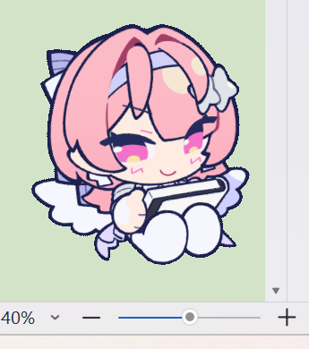
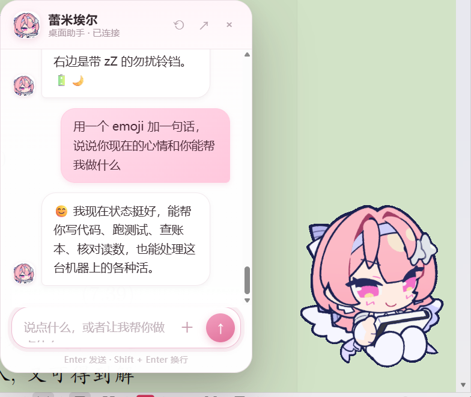

# 蕾米埃尔桌宠 · dsh-pet-remielle-desktop

把「小蕾米 · 全帧版」的 754 帧素材做成**常驻 Windows 桌面**的桌宠：透明置顶窗、原生分辨率动画、能在桌面上直接和 DSH 智能体对话和派活。

> A transparent, always-on-top desktop pet for [DeepSeek Harness](https://github.com/deepseek-ai/dsh) on Windows. 754 hand-cleaned frames, real DSH agent chat, four-way smart layout.




## 是什么

- **真桌面窗**：独立的 Neutralino 窗口（透明 / 无边框 / 置顶 / 不进任务栏），不是网页里的浮层。播放 6 个状态的原生 340×304 动画 WebP：待机、思考、工具调用、边想边写、等待、完成，全部按原始帧率 30 ms 播放，放大也不糊。
- **能干活**：桌面上发一句话，她就真的开一个 DSH 智能体会话去干活（默认当前工作区、workspace-write 权限）。她调工具、跑命令、读文件的过程就是她自己在 DSH 里的过程；会话同时出现在 DSH Web GUI 的会话列表里，可以接着聊、接着派活。
- **四向自适应**：宠物在屏幕右半边时聊天卡片向左展开，在左半边时向右展开；靠近屏幕顶部/底部时卡片自动下移/上抬。开合聊天时宠物本人的屏幕位置一动不动。
- **图片与 emoji**：输入框旁的 ＋ 可以发图片（png/jpg/webp/gif/bmp，最多 4 张）给她看；她回复里的 emoji 正常彩色渲染，回复中的图片路径/URL 也会内联成缩略图，点一下看大图。
- **全屏让位**：前台是全屏游戏或全屏视频时，自动取消置顶并隐藏，退出全屏自动回来（不会盖在游戏上）。
- **可收起、可关闭**：宠物右上角悬浮 − / + / ×，调整大小（0.5×–2×，0.25 步进）、收起成 64×64 圆形徽章。小圆可以像宠物一样拖动、单击展开。右键菜单里「完全关闭蕾米埃尔」会结束窗口和进程；叫回来发一句 `/pet on` 就行。
- **记得住**：对话、窗口位置、缩放都落盘；重启 DSH 之后接着上次继续。

## 安装

要求：Windows 10/11、DSH 0.2.x 及以上。运行时（Neutralino）已随包内置，安装时不跑任何构建脚本，不需要 allowBuilds。

### 从 GitHub 安装

```
plugin_manager install_bundle target="github:Cyrus0719/dsh-pet-remielle"
```

命令行等价写法：

```bash
dsh plugin --profile <profile> add github:Cyrus0719/dsh-pet-remielle
```

### 从 npm 安装

```
plugin_manager install_bundle target="npm:dsh-pet-remielle-desktop"
```

命令行等价写法：

```bash
dsh plugin --profile <profile> add dsh-pet-remielle-desktop
```

### 从本地目录安装

```
plugin_manager install_bundle target="file:C:/Users/<你>/dsh-pet-remielle"
```

安装完成即启用（cordis.patch.yml 里插入 pet-remielle），桌面上应该出现蕾米埃尔。窗口没出现时检查插件条目是不是 active；改过插件代码后需要重载：把条目关掉再打开一次。

如果 runtime/neutralino-win_x64.exe 丢了（比如你只复制了部分文件），执行 node scripts/install-neutralino.mjs 重新下载。

### 卸载

```
plugin_manager remove_bundle target="dsh-pet-remielle-desktop"
```

再删掉 %USERPROFILE%\\.dsh\\desktop-pet（对话、位置、缩放记忆都在里面）。
## 用

| 操作 | 结果 |
| --- | --- |
| 单击宠物 | 开 / 关聊天卡片 |
| 右键宠物 | 和她聊天 / 新开一个会话 / 在 DSH 里打开这个会话 / 收起成小圆 / 完全关闭蕾米埃尔 |
| 拖动小圆 | 换位置（记住）；单击小圆展开回宠物 |
| 宠物右上角悬浮 − / + | 缩小 / 放大（0.5×–2×，0.25 步进，记住） |
| 宠物右上角悬浮 × | 收起成 64×64 圆形徽章，点徽章恢复 |
| 拖动宠物 | 换位置（记住） |
| 聊天头部 ⟲ / ↗ / × | 新会话 / 在 DSH Web GUI 打开该会话 / 收起聊天 |
| 输入框 ＋ | 选图片发给她（最多 4 张） |
| Enter / Shift+Enter | 发送 / 换行 |

「完全关闭蕾米埃尔」会结束窗口和它自己的进程，并且不会自己回来（插件本身仍然开着）。叫回来有两种办法：

1. 在任意 DSH 会话里发 `/pet on`（`/pet off` 等同完全关闭）；
2. 在插件面板里把 dsh-pet-remielle-desktop 关掉再启用一次。

只想暂时收起来就点「收起成小圆」，宠物位置和对话都不会丢。

## 数据放在哪

- `%USERPROFILE%\.dsh\desktop-pet\chat.json` — 最近 60 条对话 + 当前会话 id
- `%USERPROFILE%\.dsh\desktop-pet\position.json` — 窗口坐标
- `%USERPROFILE%\.dsh\desktop-pet\ui.json` — 缩放比例

对话本体在 DSH 会话里（chat.json 只是摘录），所以在 DSH Web GUI 的会话历史里能看到同一个 session，可以继续聊。

## 宠物素材与状态

`assets/pets/remielle/pet.json`：

```json
{
  "id": "remielle",
  "displayName": "蕾米埃尔",
  "cell": [340, 304],
  "animations": {
    "idle": "anims/idle.webp",
    "thinking": "anims/thinking.webp",
    "tool": "anims/tool.webp",
    "review": "anims/review.webp",
    "waiting": "anims/waiting.webp",
    "done": "anims/done.webp"
  }
}
```

想换成别的宠物：在 `assets/pets/<id>/` 放同名结构的 `pet.json` + 透明动画 WebP，然后把 `cordis.patch.yml` 里的 `petId` 改掉；也可以放进 `%USERPROFILE%\.dsh\desktop-pet\pets\<id>\`（用户目录优先于包内）。

## 实现说明

- 窗口后端、状态机、宠物目录约定来自 [dsh-desktop-pet](https://github.com/sereinmono/dsh-desktop-pet)（MIT）。
- 本包在它基础上做的事：原生分辨率动画帧流（不再用 8×9 精灵图）、聊天卡片（真实 DSH 会话 / 图片 / emoji / 四向布局 / 自动滚到底）、状态机修复（`tool/result` 不回落导致"一直画画"、断开会话残留任务）、全屏让位、缩放与位置持久化、收起徽章、去托盘。
- 前端是 `assets/neutralino/resources/index.html` 一份文件；host 是 `lib/index.js`。

## 素材与署名（重要）

- 素材作者：**HanaAyane / 小蕾米** — https://github.com/HanaAyane/remielle-codex-pet
- 衍生自《绝区零》同人素材，动作经人工逐帧整理 + AI 辅助重绘；本包只做格式转换（GIF → 透明 WebP）。
- **仅限个人非商业同人使用**：禁止销售、付费分发、改名冒充、商标注册，禁止暗示米哈游 / HoYoverse 官方授权。转发请保留署名与仓库链接。
- 详见 [NOTICE.md](NOTICE.md) 与 [ASSET-USAGE.md](ASSET-USAGE.md)。

## 许可

代码：MIT（见 [LICENSE](LICENSE)，含上游 dsh-desktop-pet 的 MIT 声明）。
内置宠物素材：不适用 MIT，版权归 HanaAyane / 小蕾米，仅限个人非商业同人使用。
